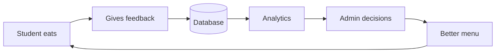
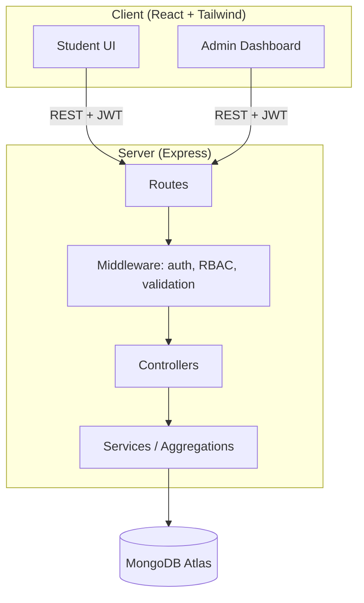
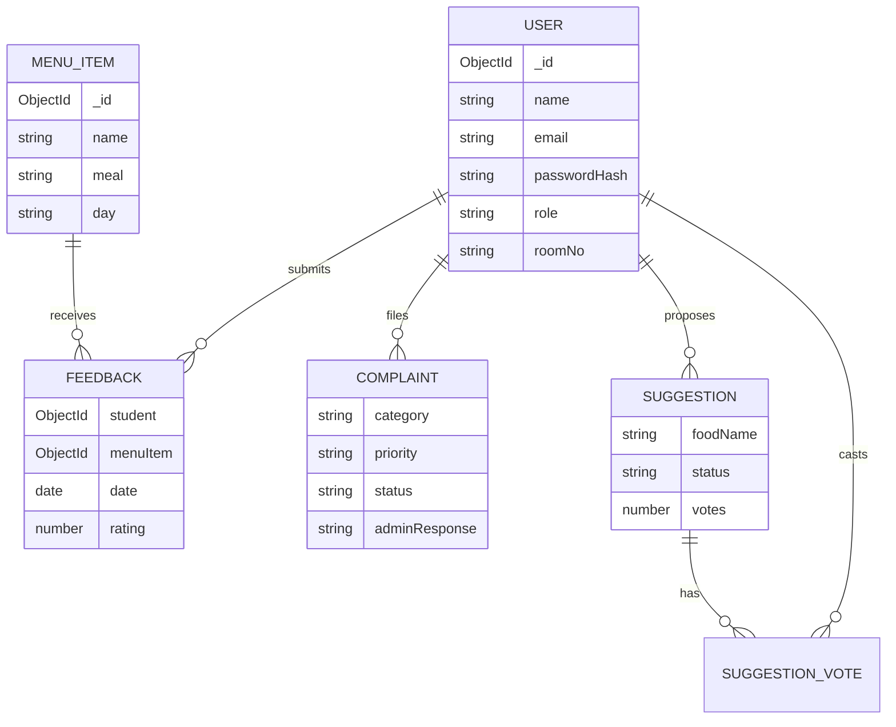

<div align="center">

# 🍽️ MessMate

### Hostel Mess Menu & Feedback Management System

**Turn subjective opinions about mess food into structured, actionable data.**


[Features](#-features) · [Architecture](#-architecture) · [Quick Start](#-quick-start) · [API](#-api-overview) · [Roadmap](#-roadmap) · [Contributing](#-contributing)

</div>

---

## 📖 Table of Contents

- [The Problem](#-the-problem)
- [The Solution](#-the-solution)
- [Features](#-features)
- [User Roles (RBAC)](#-user-roles-rbac)
- [Tech Stack](#-tech-stack)
- [Architecture](#-architecture)
- [Data Model](#-data-model)
- [Analytics: How Decisions Are Made](#-analytics-how-decisions-are-made)
- [API Overview](#-api-overview)
- [Quick Start](#-quick-start)
- [Environment Variables](#-environment-variables)
- [Repository Structure](#-repository-structure)
- [Security](#-security)
- [Testing](#-testing)
- [Deployment](#-deployment)
- [MVP Scope & Roadmap](#-mvp-scope--roadmap)
- [Contributing](#-contributing)
- [License](#-license)

---

## 🎯 The Problem

In a hostel with 500+ students, the mess menu is largely fixed and there is no reliable way to know:

- Which food students actually **like or dislike**
- What students **want added** to the menu
- How **satisfied** students are with a given meal
- Which items receive **repeated complaints**
- Which days and meals score **highest or lowest**
- Whether complaints are actually being **resolved**

A WhatsApp group or a physical complaint register cannot answer any of this with real data. Loud voices dominate, quiet majorities go unheard, and nothing is measurable.

## 💡 The Solution

MessMate gives students a fast, low-friction way to **rate meals, suggest food, and file complaints**, and gives admins a dashboard that converts raw feedback into decisions: **keep, improve, reduce, or remove**.



This **feedback → data → analytics → decision** loop is what separates MessMate from a plain CRUD app.

---

## ✨ Features

### 🎓 Student

| Feature | Details |
|---|---|
| **Authentication** | Register / login / logout with JWT-protected routes |
| **Menu view** | Daily and weekly menu, grouped by meal (breakfast, lunch, snacks, dinner) |
| **Food rating** | 1–5 stars per meal item |
| **Duplicate-vote prevention** | One rating per student / meal / day, enforced by a **unique compound index at the DB level** |
| **Suggestions** | Propose new dishes and upvote other students' suggestions |
| **Complaints** | Submit with category and priority |
| **Complaint tracking** | Follow status: `Pending → Under Review → In Progress → Resolved` |

### 🛠️ Admin

| Feature | Details |
|---|---|
| **Menu CRUD** | Create, update, and delete menu items and weekly schedules |
| **Rating analytics** | Per food item, per meal, per day, per week |
| **Complaint dashboard** | Filter, change status, and post admin responses |
| **Suggestion review** | Approve or reject student suggestions |
| **KPI dashboard** | Total students, today's responses, average rating, complaint counts, pending complaints, most/least popular food |
| **Participation rate** | Share of students who gave feedback per day/meal |
| **Student management** | View and manage student accounts |

---

## 🔐 User Roles (RBAC)

| Capability | Student | Admin |
|---|:---:|:---:|
| View menu | ✅ | ✅ |
| Vote / submit feedback | ✅ | ❌ |
| Suggest food | ✅ | ❌ |
| Submit complaint | ✅ | ❌ |
| View own complaints | ✅ | — |
| Create / update / delete menu | ❌ | ✅ |
| View analytics | ❌ | ✅ |
| Manage complaints | ❌ | ✅ |
| Manage suggestions | ❌ | ✅ |
| Manage students | ❌ | ✅ |

> ⚠️ Role checks are enforced **server-side** on every protected route. Hiding an "Admin" button in React is **not** access control.

---

## 🧰 Tech Stack

| Layer | Choice | Why |
|---|---|---|
| Frontend | **React.js** | Component-based, great for dashboards, huge ecosystem |
| Styling | **Tailwind CSS** | Fast, consistent, minimal custom CSS |
| Backend | **Node.js + Express** | JavaScript everywhere; well suited to REST APIs and I/O-heavy workloads |
| Database | **MongoDB** | Flexible document model fits varied entities (users, menus, feedback, complaints, suggestions) |
| ODM | **Mongoose** | Schemas, validation, indexes, middleware |
| Auth | **JWT + bcrypt** | Stateless auth; passwords never stored in plaintext |
| Charts | **Recharts** | Admin analytics visualizations |
| Deployment | **Vercel** (frontend) · **Render / Railway** (backend) · **MongoDB Atlas** (DB) | Simple, low-cost, standard MERN path |

---

## 🏗️ Architecture



**Request lifecycle:** `Route → Auth middleware → Role middleware → Validation → Controller → Service → Mongoose model → Response`

Deeper dive, including backend layering and design decisions: [`docs/architecture.md`](docs/architecture.md).

---

## 🗄️ Data Model



**Key integrity rule:** `Feedback` has a unique compound index on `{ student, menuItem, date }`, so duplicate votes are rejected by the database itself, not just by UI logic or race-prone application checks.

Full schemas and indexes: [`docs/database.md`](docs/database.md).

---

## 📊 Analytics: How Decisions Are Made

Admins don't just see averages. The dashboard maps each item to an action:

| Signal | Example rule (tunable) | Suggested action |
|---|---|---|
| High rating, high participation | avg ≥ 4.0 | ✅ **Keep** |
| Mid rating | 3.0 ≤ avg < 4.0 | 🔧 **Improve** (check linked complaints) |
| Low rating, frequent in menu | avg < 3.0 | ⬇️ **Reduce frequency** |
| Persistently low + repeated complaints | avg < 2.0 over several weeks | ❌ **Remove / replace** |
| Highly upvoted suggestion | top votes | ➕ **Add to menu** |

Core metrics: average rating per item/meal/day/week, participation rate (`responders ÷ total students`), complaint volume by category, and complaint resolution time.

> Thresholds above are illustrative defaults and should be configured per hostel.

---

## 🔌 API Overview

Base URL: `/api/v1`. All protected routes require `Authorization: Bearer <token>`.

| Area | Method & Endpoint | Access |
|---|---|---|
| **Auth** | `POST /auth/register` · `POST /auth/login` · `GET /auth/me` | Public / Auth |
| **Menu** | `GET /menu` · `POST /menu` · `PUT /menu/:id` · `DELETE /menu/:id` | Auth / Admin |
| **Feedback** | `POST /feedback` · `GET /feedback/mine` | Student |
| **Suggestions** | `POST /suggestions` · `POST /suggestions/:id/vote` · `PATCH /suggestions/:id/status` | Student / Admin |
| **Complaints** | `POST /complaints` · `GET /complaints/mine` · `GET /complaints` · `PATCH /complaints/:id` | Student / Admin |
| **Analytics** | `GET /analytics/kpis` · `GET /analytics/ratings` · `GET /analytics/participation` | Admin |

Full request/response reference: [`docs/api.md`](docs/api.md).

---

## 🚀 Quick Start

### Prerequisites

- Node.js **18+** and npm
- A MongoDB instance (local, or a free [MongoDB Atlas](https://www.mongodb.com/atlas) cluster)
- Git

### 1. Clone

```bash
git clone https://github.com/<your-org>/mess-menu-system.git
cd mess-menu-system
```

### 2. Backend

```bash
cd server
cp .env.example .env      # then fill in values (see below)
npm install
npm run seed              # optional: sample menu, students, and an admin
npm run dev               # http://localhost:5000
```

### 3. Frontend

```bash
cd client
cp .env.example .env
npm install
npm run dev               # http://localhost:5173
```

### Default seeded accounts *(development only)*

| Role | Email | Password |
|---|---|---|
| Admin | `admin@messmate.dev` | change on first login |
| Student | `student@messmate.dev` | change on first login |

More detail and troubleshooting: [`docs/setup.md`](docs/setup.md).

---

## ⚙️ Environment Variables

**`server/.env`**

| Variable | Description | Example |
|---|---|---|
| `PORT` | API port | `5000` |
| `MONGO_URI` | MongoDB connection string | `mongodb+srv://...` |
| `JWT_SECRET` | Long random string for signing tokens | `use-a-32+-char-secret` |
| `JWT_EXPIRES_IN` | Token lifetime | `7d` |
| `CLIENT_URL` | Allowed CORS origin | `http://localhost:5173` |
| `NODE_ENV` | Environment | `development` |

**`client/.env`**

| Variable | Description | Example |
|---|---|---|
| `VITE_API_URL` | Backend base URL | `http://localhost:5000/api/v1` |

> Never commit `.env` files. Only `.env.example` belongs in version control.

---

## 📁 Repository Structure

```
mess-menu-system/
├── client/                # React + Tailwind frontend
├── server/                # Express + Mongoose backend
├── docs/
│   ├── architecture.md    # System & backend architecture, diagrams
│   ├── api.md             # Full REST API reference
│   ├── database.md        # Schemas, indexes, ER relationships
│   ├── setup.md           # Local dev setup & onboarding
│   └── contribution.md    # Branching strategy, team roles, definition of done
├── README.md
├── .gitignore
└── LICENSE
```

---

## 🛡️ Security

- Passwords hashed with **bcrypt**; never logged or returned in responses
- **JWT** auth with expiry; secrets loaded from environment only
- **Server-side RBAC** on every protected route
- **Input validation** on all write endpoints (e.g. Zod / express-validator)
- **Rate limiting** on auth routes to slow brute-force attempts
- **Helmet** and a strict **CORS** allow-list
- **Mongo injection** protection via sanitization of request bodies
- DB-level **unique indexes** for integrity rules (duplicate votes)

---

## 🧪 Testing

```bash
# Backend
cd server && npm test

# Frontend
cd client && npm test
```

Priorities for test coverage: auth and RBAC guards, duplicate-vote rejection, analytics aggregations, and complaint status transitions.

---

## ☁️ Deployment

| Component | Platform | Notes |
|---|---|---|
| Frontend | Vercel | Set `VITE_API_URL` to the deployed API |
| Backend | Render / Railway | Set all server env vars; enable health check on `/api/v1/health` |
| Database | MongoDB Atlas | Allow-list the backend's IPs; use a dedicated DB user |

---

## 🗺️ MVP Scope & Roadmap

### ✅ MVP (v1)

1. Authentication (Student / Admin roles)
2. Menu management
3. Food rating (1–5 stars)
4. Complaints
5. Food suggestions
6. Basic admin analytics

### 🔮 Planned

- [ ] Notifications (email / push) for complaint updates
- [ ] QR-code feedback at the mess counter
- [ ] Mess-manager role
- [ ] Multi-hostel support
- [ ] Recommendation engine for menu planning
- [ ] CSV / PDF export of analytics reports
- [ ] Anonymous feedback mode

Details: [`docs/architecture.md#future-features`](docs/architecture.md#future-features).

---

## 🤝 Contributing

Contributions are welcome. Please read [`docs/contribution.md`](docs/contribution.md) for the branching strategy, team responsibilities, and the **Definition of Done**.

Quick flow:

1. Fork and create a branch: `feature/<short-name>`
2. Commit with clear messages
3. Open a PR with a description and screenshots for UI changes

---

## 📚 Documentation Index

| Doc | Purpose |
|---|---|
| [`docs/architecture.md`](docs/architecture.md) | System design, layering, future features |
| [`docs/api.md`](docs/api.md) | REST API reference |
| [`docs/database.md`](docs/database.md) | Schemas, indexes, relationships |
| [`docs/setup.md`](docs/setup.md) | Local setup and onboarding |
| [`docs/contribution.md`](docs/contribution.md) | Workflow and Definition of Done |

---

## 📄 License

Released under the [MIT License](LICENSE). Update the copyright holder in `LICENSE` before publishing.

<div align="center">

Built to make hostel food better, one rating at a time. 🍛

</div>
